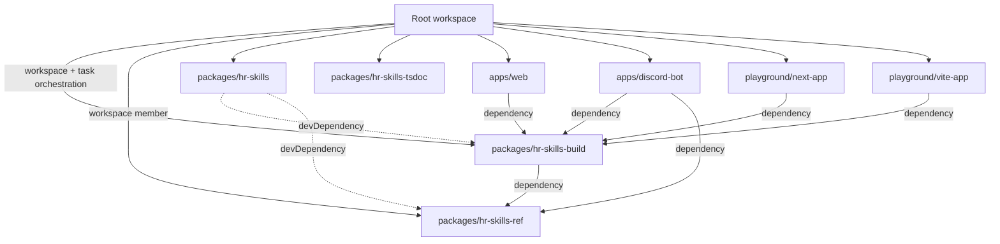
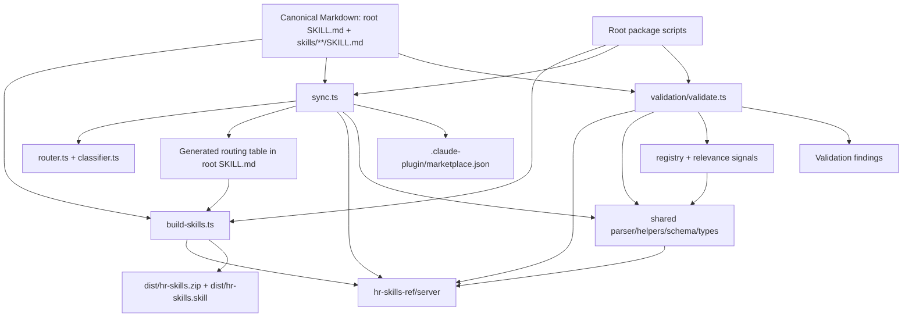

# Skill Build Consumer and Import Graph

- **Status:** Evidence-based migration analysis
- **Date:** 2026-11-07
- **Related issue:** [#287](https://github.com/tuanductran/hr-skills/issues/287)
- **Design boundary:** [Minimal Skill Build Boundary](minimal-build-boundary.md)
- **Product-scope authority:** [ADR 0001 — Markdown-First Product Scope](../decisions/0001-markdown-first-product-scope.md)

## Purpose and method

This document adds the consumer and dependency view that follows the command/workspace inventory in `minimal-build-boundary.md`. It distinguishes:

1. workspace dependency declarations (`package.json`);
2. direct source imports and public package entrypoints;
3. task/workflow dependencies (`turbo.jsonc` and GitHub Actions);
4. the subset of those dependencies actually needed for Markdown validation and ZIP/`.skill` distribution.

The audit is read-only against `main`. It inspected the root and workspace manifests, package entrypoints and build configurations, the retained build/validation entrypoints, known application imports, Turborepo tasks, and the relevant GitHub workflows. This is a source-level migration map, not a generated compiler/AST dependency report. Before deleting or moving modules, the implementation PR must repeat the graph check against the exact changed tree and run the complete retained workflow from a clean checkout.

No skill content, package source, dependency, workflow, or generated artifact is changed by this document.

## 1. Workspace dependency graph

The following edges are declared in workspace manifests. The edge labels distinguish production dependencies from development-only workspace dependencies.

| Workspace | Declared internal workspace dependencies | Observed role |
|---|---|---|
| Root | All `apps/*`, `packages/*`, and `playground/*` are workspaces | Owns Bun catalogs, scripts, formatting/linting and Turborepo orchestration |
| `hr-skills-build` | `hr-skills-ref` (dependency) | Mixed build, validation, registry, docs, planner, runtime, search, evaluation and service implementation |
| `hr-skills-ref` | None | Shared Agent Skills parsing, schemas, models, filesystem paths, loading, prompt and validation primitives |
| `hr-skills` | `hr-skills-build`, `hr-skills-ref` (both devDependencies) | CLI and package lifecycle/build tooling; not a runtime dependency of the skill archive |
| `hr-skills-tsdoc` | None declared | Uses `ts-morph` to inspect source entrypoints in three packages and generate `docs/engineering/api.md` |
| `apps/web` | `hr-skills-build` (dependency) | Next.js catalog and product surfaces; imports both client and server APIs |
| `apps/discord-bot` | `hr-skills-build`, `hr-skills-ref` (dependencies) | Discord adapter; imports client search/planner APIs and the reference server path |
| `playground/next-app` | `hr-skills-build` (dependency) | Client-bundle smoke test for the browser-safe package entrypoint |
| `playground/vite-app` | `hr-skills-build` (dependency) | Client-bundle smoke test for parser, search and runtime exports |

**Important distinction:** a workspace dependency is not proof that every exported module is required by the consumer. For example, `hr-skills-build` exposes large client and server barrels, while the archive builder uses one path constant from `hr-skills-ref/server`. The implementation must reduce module reachability and exports based on actual retained call paths, not merely delete a workspace because its current consumer is deferred.

## 2. Direct package consumers and import surfaces

### `hr-skills-build/client`

Observed consumers:

- `apps/web` client components: catalog search, intent analysis, planner and product-surface UI.
- `apps/discord-bot/src/registry.ts`: registry types, search, recommendations and plan generation.
- `playground/next-app/app/client-widget.tsx`: parser smoke test.
- `playground/vite-app/src/App.tsx`: parser, search and runtime smoke test.

These imports support the deferred web, Discord, planner/runtime and playground surfaces. They are not dependencies of ZIP/`.skill` archive creation, Markdown validation, or marketplace/router synchronization.

### `hr-skills-build/server`

Observed consumers:

- `apps/web/app/lib/docs.ts`: documentation data, registry, recommendation, planner, runtime and evaluation APIs.
- `packages/hr-skills/src/cli/*`: registry/search, planner/execution, recommendation, evaluation, relevance-signal generation and skill-review APIs.
- `packages/hr-skills/src/cli/skill-review.ts`: `readSkillContent`, `validateSecurityChecks`, `scoreSkills` and related types.

The package server barrel currently re-exports ten broad areas: docs, evaluation, operations, planner, registry, runtime, search, service, shared and validation. This is a mixed public surface. The retained build commands import their internal modules directly; they do not need the entire server barrel as a conceptual API. The CLI, web and Discord consumers are separate product surfaces and should not force their feature modules into the retained build package.

### `hr-skills-ref/server`

Observed direct consumers:

- `hr-skills-build` build and validation modules: `ROOT_DIR`, `SKILLS_DIR`, and `validate`.
- `packages/hr-skills/src/cli/discover.ts` and `generate-registry.ts`: repository paths.
- `apps/discord-bot/src/registry.ts`: repository root for the committed registry.

The retained build path currently depends on the reference server entrypoint for repository path constants and core skill validation. The reference server barrel exports constants, errors, helpers, loader, models, parser, prompt, schema and validator. The client barrel separately exports pure constants, errors, helpers, models, parser and schema. Do not collapse these surfaces until every filesystem-backed and browser consumer has been mapped.

### `hr-skills-ref/client`

The explicit public client entrypoint is used by the build package's public-surface test. No current application import was found in the inspected consumer set. Its parsing/schema functionality overlaps conceptually with the build package's own client/shared parser and schema modules; whether either copy can be consolidated requires an API/test compatibility pass, not a speculative deletion.

## 3. Retained build path: module-level dependency map

The intended Markdown-to-distribution path is narrower than the current package surface:

| Entry point | Direct imports / work performed | Classification and coupling |
|---|---|---|
| `build-skills.ts` | Node filesystem/path/ZIP primitives; imports `ROOT_DIR` from `hr-skills-ref/server`; walks the distribution allowlist and writes ZIP and `.skill` artifacts | **Essential distribution path.** It does not need planner, runtime, search, registry, service, evaluation, docs-data or CLI features. Its dependency on the broad reference server barrel is wider than the single path constant it consumes. |
| `sync.ts` | Node filesystem/path; `@clack/prompts`; `valibot`; `ROOT_DIR`; skill discovery; metadata parsing; marketplace schema; router generator | **Conditional generator.** Needed only while the Claude marketplace manifest and root routing table remain supported derived artifacts. It does not need the CLI product. |
| `router.ts` | `ROOT_DIR`/`SKILLS_DIR`; classifier; skill discovery; frontmatter parser | Generates only the `## Routing tables` section. Skill descriptions and classifier metadata are inputs; the table itself is generated. |
| `validate.ts` | Reference `validate`; paths; parser/helpers/constants/types; security, semantic, duplicate and quality validation; registry and relevance-signal validation | **Mixed validator.** Core Markdown/Agent Skill checks are essential; registry staleness, signal consistency, semantic scoring and related product checks are candidates for separation if the Markdown-first contract does not require them. Do not weaken security checks during extraction. |
| `generate-skill-matrix.ts` | Reference paths; `computeTier`, `countFiles`, discovery and Markdown metadata helpers | Optional generated documentation. It does not require planner/runtime/search/CLI APIs. |
| `generate-docs-data.ts` and docs loader | Reference paths; documentation loader and registry data | Web-app data pipeline; defer with `apps/web`, not part of distribution build. |

### Important coupling and task-graph finding

`build-skills.ts` imports `ROOT_DIR` from `hr-skills-ref/server`. The reference package's `exports` map points that subpath to `dist/server/index.mjs`, and its build config emits that file from TypeScript source.

In `turbo.jsonc`, the `build-skills` task is marked `cache: false` but does **not** declare `dependsOn: ["^build"]`. By contrast, `validate`, `sync`, and `matrix` do declare the upstream build dependency. The `.github/workflows/publish.yml` workflow runs validation before `build-skills`, which currently gives the reference package a prior build opportunity. A direct clean-checkout invocation of `bun run build-skills` is therefore a task-graph risk that has not been proven independently by this static audit.

**Implementation requirement:** verify `bun run build-skills` from a clean checkout with no pre-existing `dist/`. Either declare the required upstream build edge or remove the unnecessary compiled-package dependency from the archive entrypoint. Do not rely on an incidental earlier command.

## 4. CLI and review-only consumers

The `hr-skills` package's source imports `hr-skills-build/server` for:

- registry/search and listing;
- planner and workflow execution;
- recommendations and relevance signals;
- evaluation and golden fixtures;
- deterministic skill review.

Some commands also import `hr-skills-ref/server` for repository paths. The package manifest declares both workspace packages as development dependencies, and the package is a separate CLI product rather than a dependency of the skill archive.

**Review-only exception:** `skill-review` is used by `.github/workflows/skill-review.yml` to produce a non-blocking deterministic report for changed skills. It calls content loading, security checks and quality scoring. It is not equivalent to the planner/runtime CLI. Keep this workflow useful by extracting the review operation into a focused Markdown-quality entrypoint or retained package API before deferring the broader CLI package. Preserve the security checks and report contract.

## 5. TSDoc and generated API coupling

`packages/hr-skills-tsdoc` has no declared workspace dependency on the three packages it documents. Its generator uses `ts-morph` and hard-coded source entrypoints for:

- `packages/hr-skills/src/bin/hr-skills.ts`;
- `packages/hr-skills-build/src/server/index.ts` and `src/client/index.ts`;
- `packages/hr-skills-ref/src/server/index.ts` and `src/client/index.ts`.

It writes `docs/engineering/api.md`. This tool therefore couples documentation generation to the continued existence and shape of the TypeScript public APIs, even without package import edges. If the public TypeScript libraries and CLI are deferred, the generator and generated API reference should be reviewed together in a separate documentation-retirement change. Do not leave a generator targeting deleted entrypoints.

## 6. CI, release and generated-artifact dependencies

| Workflow / command | Observed behavior | Consequence for scope reduction |
|---|---|---|
| `.github/workflows/test.yml` | Runs root `test`, then root `build`; root `build` invokes Turborepo across non-root workspaces | CI currently builds apps and playgrounds as well as packages. The playground builds are explicitly browser-client smoke tests. Narrowing this workflow requires replacing that smoke-test coverage or explicitly retiring it. |
| `.github/workflows/typecheck.yml` | Runs root `typecheck` across non-root workspaces | Currently typechecks deferred apps/packages as well as retained tooling. Replace with a retained-tooling typecheck only after consumers are removed or intentionally deferred. |
| `.github/workflows/validate.yml` | Runs root `validate`, filtered to `hr-skills-build`; Turborepo task declares upstream build dependency | Current validation depends on the build package and its upstream `hr-skills-ref` build. |
| `.github/workflows/lint.yml` | Runs Biome, Markdown lint/case checks and link checks | Markdown quality is core; Biome should be scoped to source/config that remains maintained. |
| `.github/workflows/knip.yml` | Runs Knip over configured app/build/ref workspaces | Knip config explicitly includes `apps/web`, `apps/discord-bot`, `hr-skills-build` and `hr-skills-ref`; re-scope it after the retained boundary is implemented. |
| `.github/workflows/skill-review.yml` | For PRs changing `skills/hr-*/**`, explicitly builds `hr-skills-ref` and `hr-skills-build`, then runs `bun run skill-review` and posts a non-blocking report | Preserves a real security/quality review consumer. Extract this capability before deferring the CLI package; do not drop the workflow silently. |
| `.github/workflows/matrix.yml` | On `main`, generates the skill matrix and registry, then commits changed artifacts | Couples matrix and registry generation to every main push. Decide separately whether both artifacts remain maintained outputs. |
| `.github/workflows/release.yml` | Runs validation and Changesets versioning on main pushes | Keeps release/package versioning in the current CI lifecycle even though the product scope is Markdown-first. |
| `.github/workflows/publish.yml` | On version tags, runs validation then `build-skills`, and attaches ZIP/`.skill` artifacts to a GitHub Release | The release archive is a real retained distribution consumer. Preserve its reproducibility and validate the clean-checkout build edge above. |

The committed `registry/skills.json` is consumed by the deferred web/Discord product surfaces and validated by the current broad validator. It is not read by `build-skills.ts` or by the marketplace/router generator. Therefore, registry generation and registry validation must not be treated as inherent requirements of creating the ZIP/`.skill` archive; decide their future only after the corresponding consumers and workflow obligations are separated.

## 7. Candidate retained boundary

This table is a proposed implementation sequence, not authorization to delete or rewrite existing code.

| Candidate | Evidence-based treatment | Guardrail |
|---|---|---|
| Archive builder | Retain as the core distribution operation | Must work from a clean checkout and produce both expected formats deterministically |
| Markdown/Agent Skill parser and schema primitives | Retain the smallest required parser/schema surface | Preserve all existing skill content and validation contracts |
| Core validator | Retain frontmatter, structure, links/reference integrity and security checks required by the Markdown-first contract | Security checks must not be weakened; separate advanced registry/semantic/product checks explicitly |
| Marketplace/router sync | Keep only while those generated Claude artifacts are part of the supported distribution contract | Preserve hand-authored root preamble/footer; regenerate only the routing section |
| Skill matrix | Optional generated inventory | Keep only if maintainers still want this generated documentation |
| Skill-review report | Extract or retain as focused Markdown-quality tooling | Preserve workflow behavior, security checks and non-blocking report semantics |
| `hr-skills-ref` | Retain only the path/parser/validator APIs consumed by the narrowed build path, or inline a truly small primitive if that reduces coupling | Inspect all external and test consumers before changing exports or package ownership |
| `hr-skills-build` | Narrow to archive/sync/validation and explicitly retained metadata generators | Do not carry planner/runtime/search/service/evaluation modules into the minimal build API by default |
| CLI, web, Discord, playgrounds, TSDoc | Defer from the default build and maintenance path | Deferral is not deletion approval; each retirement needs a separate reviewed change and consumer check |

## 8. Recommended implementation sequence

1. **Make the graph executable.** Add a repeatable import/consumer inventory or script that checks package manifests, package export entrypoints, source imports, root scripts and workflow references. Keep the output deterministic.
2. **Prove the archive path independently.** On a clean checkout, run the archive builder without prebuilt workspace `dist/`; fix the missing Turborepo dependency edge or remove the avoidable compiled-package dependency.
3. **Extract the minimum shared primitives.** Separate filesystem paths, frontmatter parsing/schema, discovery and core validation from registry/planner/runtime/search/evaluation/service modules. Preserve existing public behavior until consumer migrations are complete.
4. **Separate review from CLI.** Move the `skill-review` workflow's deterministic security/quality report to a focused retained entrypoint before deferring `packages/hr-skills`.
5. **Move root orchestration to thin scripts.** Add only the required `scripts/` entrypoints; keep implementation logic in the smallest reusable package surface. Do not duplicate package logic in scripts.
6. **Re-scope CI after consumer migration.** Keep Markdown lint/link checks, core validation, archive build, and tests for retained modules. Retire or isolate app/playground builds, broad typecheck/test tasks, registry/matrix automation and API-doc generation only after their consumers are intentionally deferred.
7. **Remove packages/exports/dependencies only in separate PRs.** For each removal, show zero remaining source, test, workflow, documentation-generator and package-manifest consumers; run clean install, focused tests, validation, and both archive builds.

## 9. Evidence index

Primary source files inspected:

- Root `package.json`, `turbo.jsonc`, `knip.config.ts`, and workspace manifests for all four packages, both apps and both playgrounds.
- `packages/hr-skills-build/tsdown.config.ts`, `packages/hr-skills-ref/tsdown.config.ts`, and `packages/hr-skills/tsdown.config.ts`.
- Build path: `packages/hr-skills-build/src/server/build/build-skills.ts`, `sync.ts`, `router.ts`, `generate-skill-matrix.ts`, `generate-docs-data.ts`.
- Validation and shared primitives: `packages/hr-skills-build/src/server/validation/validate.ts`, `validate-registry.ts`, `shared/helpers.ts`, `shared/paths.ts`, `registry/discovery.ts`, `registry/registry.ts`.
- Package entrypoints: `packages/hr-skills-build/src/{client,server}/index.ts` and `packages/hr-skills-ref/src/{client,server}/index.ts`.
- Product consumers: `apps/web/app/lib/docs.ts`, `apps/web/app/components/*`, `apps/discord-bot/src/registry.ts`, `playground/next-app/app/client-widget.tsx`, `playground/vite-app/src/App.tsx`, and `packages/hr-skills/src/cli/*`.
- Review/API documentation consumers: `packages/hr-skills/src/cli/skill-review.ts`, `packages/hr-skills-tsdoc/src/generate-api-docs.ts`.
- Workflow evidence: `.github/workflows/{test,typecheck,validate,lint,knip,skill-review,matrix,release,publish}.yml`.

This graph should be treated as the review baseline for implementation, not as evidence that any deferred package or feature has already been removed.
